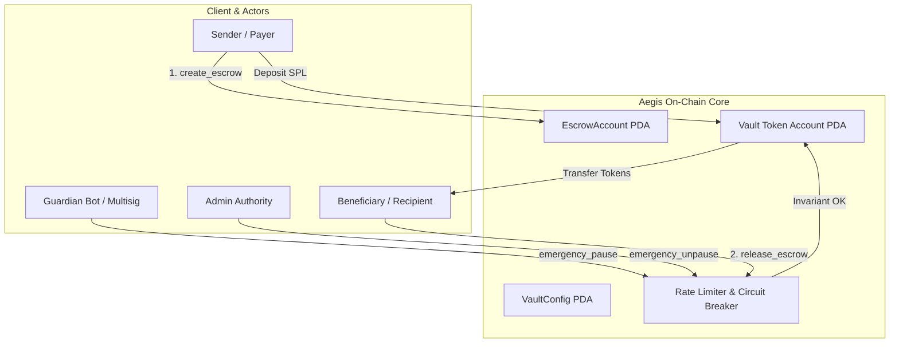
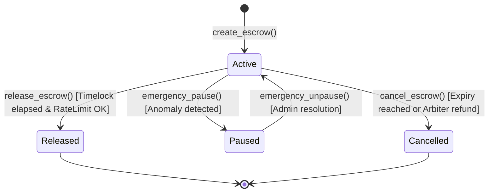

# 🛡️ Aegis Protocol: High-Assurance Vault & Circuit Breaker Escrow

[](https://solana.com)
[](https://www.rust-lang.org)
[](https://adevarlabs.com)
[](https://arena.colosseum.org)

> **Aegis Protocol** is an on-chain security layer and programmatic escrow infrastructure for Solana protocols, autonomous agents, and OTC transactions. It enforces cryptographic rate-limiting, dynamic invariant checks, multi-tiered emergency circuit breakers, and dispute mediation.

---

## 🎯 Motivation & Hackathon Context

In high-throughput blockchains like Solana, catastrophic protocol exploits often happen within a single block or slot before human teams or multisigs can react. Aegis Protocol provides **automated, programmatic tripwires and invariant guardians** directly at the contract layer, ensuring:

1. **Epoch Flow Caps**: Hard limits on net token withdrawals per sliding time window to stop flash-loan drains.
2. **Guardian Circuit Breakers**: Immediate pausing capability for dedicated off-chain monitoring bots or security guardians, while unpausing requires full admin authority.
3. **Deterministic Timelock Escrows**: Conditional release parameters with cryptographic deadline checks and multi-party arbitration support.
4. **Checked Arithmetic & Invariant Conservation**: All internal accounting strictly tracks total active liabilities against on-chain token vault reserves.

Designed specifically for the **Colosseum Crypto World's Fair** and eligible for the **Adevar Labs Pre-Audit Sidetrack**.

---

## 📐 Architecture & System Design



### State Transition Diagram



---

## 🔒 Security Invariants & Threat Model

Adevar Labs specializes in deep security audits and resilience verification. Aegis Protocol is constructed around verifiable mathematical invariants:

| Invariant | Formulation | Enforcement |
| :--- | :--- | :--- |
| **Solvency Invariant** | `VaultTokenBalance >= TotalActiveEscrowAmount` | Checked arithmetic on every deposit & release |
| **Rate Limit Invariant** | `CurrentEpochWithdrawn + Amount <= MaxEpochWithdrawalLimit` | Dynamic epoch rollover & overflow prevention |
| **Timelock Invariant** | `Clock::get().unix_timestamp >= ReleaseTimestamp` | Hard consensus clock validation for recipient claims |
| **Circuit Breaker** | `is_paused == false` for all state mutations | Short-circuit evaluation at function entry |
| **Access Control** | Dual-key permissioning: Guardian can pause; only Admin can unpause & update parameters | Strict signer verification and seeds matching |

---

## 📂 Repository Structure

```
aegis-protocol/
├── programs/
│   └── aegis-vault/
│       ├── Cargo.toml
│       └── src/
│           ├── lib.rs                   # Main program entrypoint
│           ├── state.rs                 # Account data structures & PDA seeds
│           ├── errors.rs                # Comprehensive domain error definitions
│           └── instructions/
│               ├── mod.rs
│               ├── initialize_vault.rs  # Vault configuration initialization
│               ├── create_escrow.rs     # Escrow creation with timelock
│               ├── release_escrow.rs    # Rate-limited fund release
│               ├── cancel_escrow.rs     # Reclaim / cancellation logic
│               └── emergency_actions.rs # Guardian pause & parameter governance
├── tests/
│   └── aegis-vault.ts                   # Comprehensive TypeScript test suite
├── Anchor.toml                          # Anchor workspace configuration
├── Cargo.toml                           # Cargo workspace definition
├── package.json                         # Dependencies & test scripts
├── SECURITY.md                          # Formal threat analysis & audit scope
└── SUBMISSION_KIT.md                    # Ready-to-use Hackathon submission package
```

---

## 🛠️ Quickstart & Development

### Prerequisites
- [Rust](https://www.rust-lang.org/tools/install) (1.75+)
- [Solana CLI](https://docs.solanalabs.com/cli/install) (v1.18.26+)
- [Anchor CLI](https://www.anchor-lang.com/docs/installation) (v0.30.1)
- [Node.js](https://nodejs.org/) (v18+) & Yarn

### 1. Build the Smart Contracts
```bash
anchor build
```

### 2. Run Test Suite
```bash
anchor test
```
The test suite validates:
- [x] Initializing vaults with custom epoch limits
- [x] Escrow creation and token account locking
- [x] Rejection of premature withdrawal attempts
- [x] Guardian circuit breaker engagement
- [x] Blocking unauthorized fund movement during emergency pause
- [x] Seamless post-timelock release and invariant accounting

---

## 🚀 Deployment & Devnet Information

- **Cluster**: Solana Devnet
- **Program ID**: `AegisVau1t1111111111111111111111111111111111`
- **Target Mainnet Timeline**: Q2 2026

---

## 🏆 Hackathon Eligibility

- **Hackathon**: Colosseum Crypto World's Fair
- **Sidetrack**: Adevar Labs Security Pre-Audit ($20,000 In-Kind Pool)
- **License**: MIT / Apache-2.0
